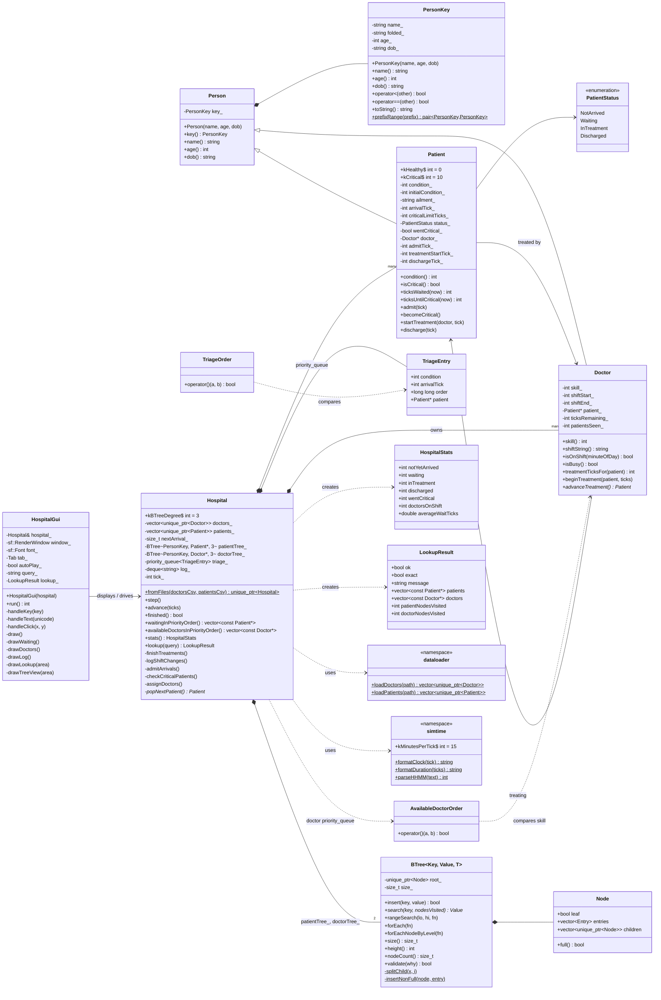

# UML Class Diagram

GitHub renders the diagram below automatically. (`+` public, `-` private, `#` protected.)
A picture of the same diagram, for viewers that do not render Mermaid, is in [docs/UML.png](docs/UML.png) and [docs/UML.pdf](docs/UML.pdf).

